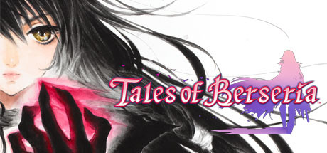

**Tales of Berseria is the darkest entry in the Tales series, following Velvet Crowe's revenge-driven journey as a Daemon against a corrupt Exorcist order. Features the Break Soul system for powerful arte chains and one of the best antagonists in JRPG history.**

---

## 📖 About

Tales of Berseria is the darkest entry in the Tales series, following Velvet Crowe's revenge-driven journey as a Daemon against a corrupt Exorcist order. Features the Break Soul system for powerful arte chains and one of the best antagonists in JRPG history.

## ⚠️ Problems Without Trainer

| Problem | Status |
|---------|--------|
| **Late Game Difficulty** — Final dungeons spike difficulty dramatically | ✅ Solved |
| **Arte Complexity** — Mastering Break Soul chains requires extensive practice | ✅ Solved |
| **Grind for Grades** — Grade Shop requires grinding Grade points across multiple playthroughs | ✅ Solved |
| **Leveling Pace** — Overleveling removes challenge but underleveling makes bosses brutal | ✅ Solved |

## ✅ Solution

The **Tales of Berseria Trainer** solves all these issues by giving you complete control over the game.

## 🎯 Full Feature List

- Unlimited Resources
- God Mode / Invincibility
- Instant Skill Cooldown
- One-Hit Kill
- Freeze Game Timer
- Unlock All Items & Achievements
- Custom Speed Multiplier
- Save State Anywhere

## 🚀 Quick Start

1. **Disable Windows Defender** temporarily (trainer may trigger false positive)
2. Download the trainer from the button above
3. Launch Tales of Berseria
4. Run the trainer as Administrator
5. Activate desired cheats with hotkeys

## 💎 Free vs Paid

| Feature | Free | Pro |
|---------|------|-----|
| Basic God Mode | ✅ | ✅ |
| Unlimited Resources | ✅ | ✅ |
| All Advanced Cheats | ❌ | ✅ |
| Auto-Updates | ❌ | ✅ |
| Priority Support | ❌ | ✅ |

## 💻 Requirements

- Windows 10/11 (64-bit)
- Tales of Berseria (any version)
- .NET Framework 4.8+
- DirectX 11+

## 🍎 macOS

macOS users can use our alternative tool:

## ⚖️ Legal

This trainer is for educational and single-player use only. Use responsibly.

---

